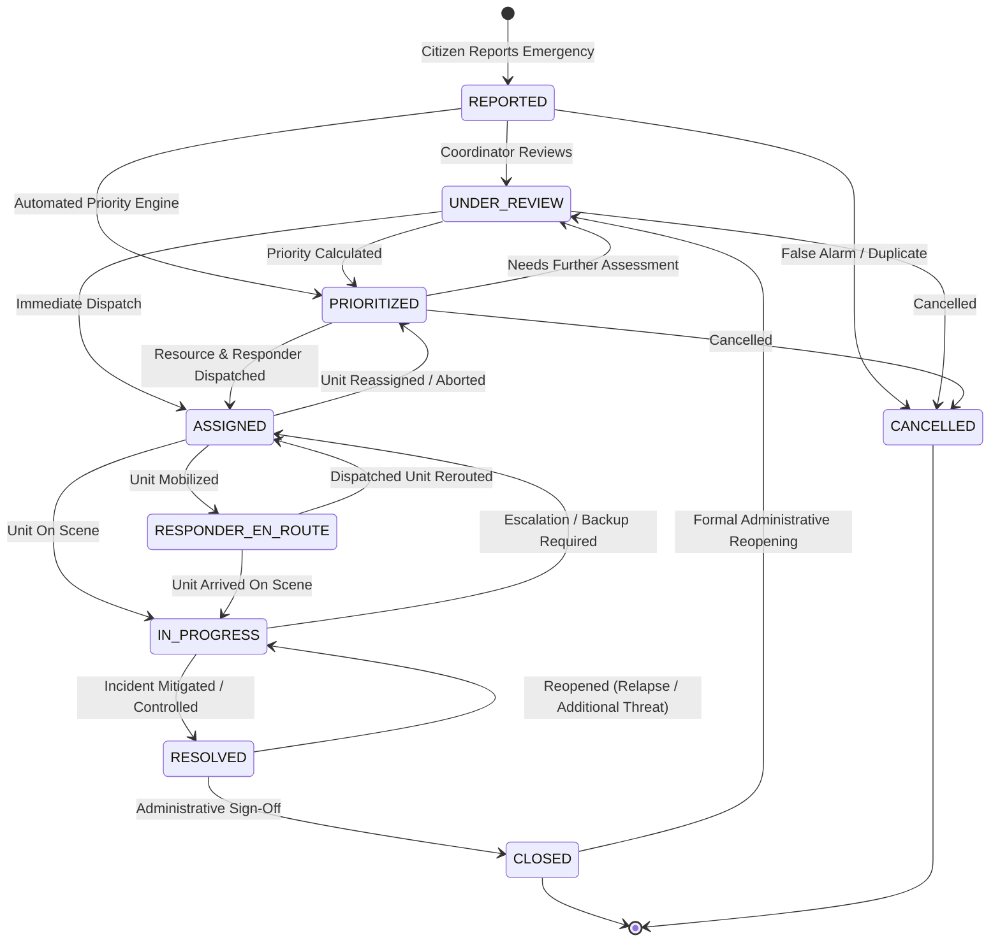
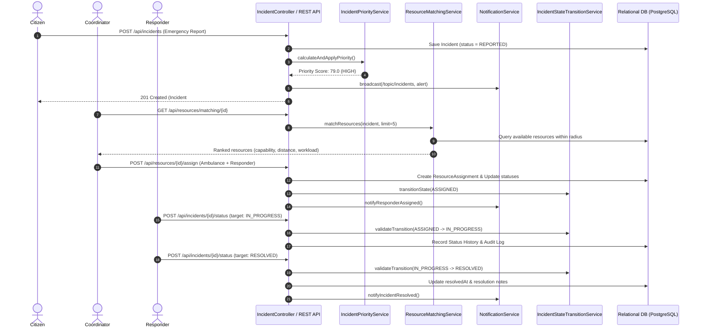
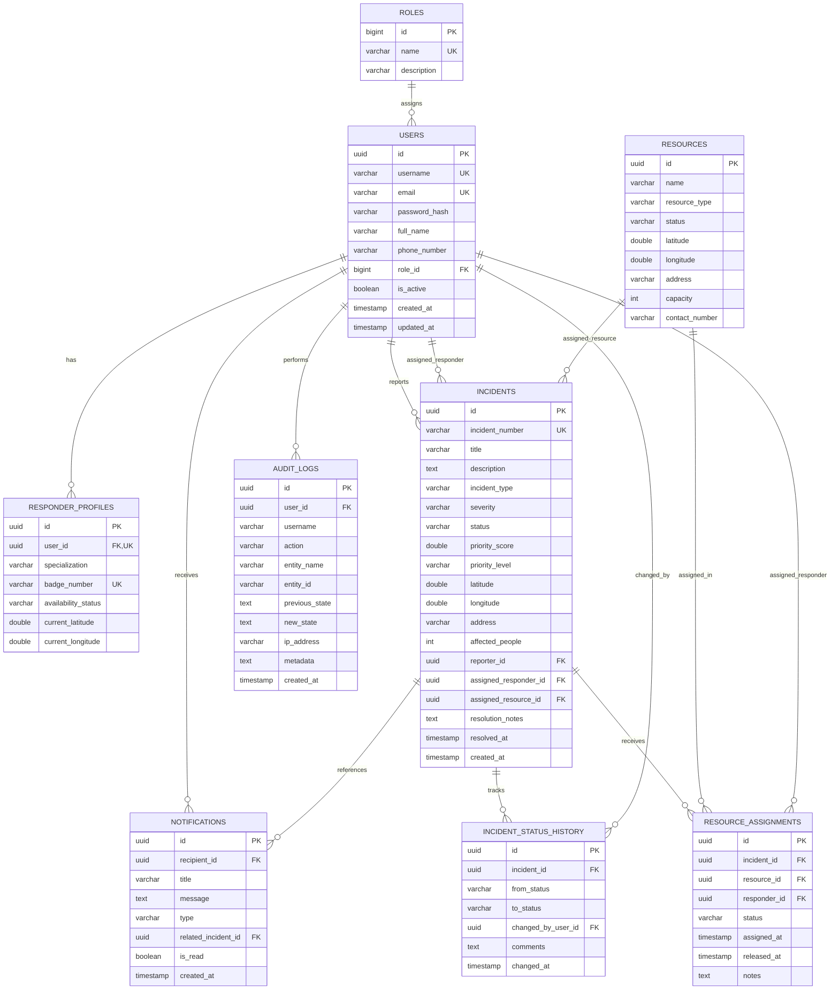
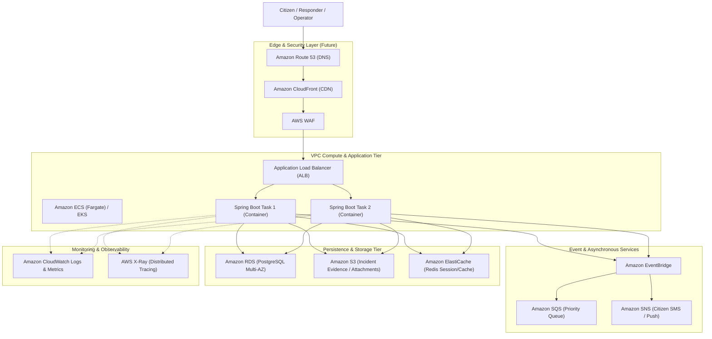

# ResQCloud — System Architecture & Design Documentation

## Intelligent Emergency Response & Resource Coordination Platform

---

## 1. Executive Architecture Summary

ResQCloud is engineered as a **Modular Monolith** applying **Domain-Driven Design (DDD)**, **Layered Architecture**, and **Clean Architecture Principles**. The application decouples business logic from frameworks and external communication transports, enabling straightforward extraction into microservices or cloud-native cloud services (e.g., AWS ECS, RDS, SQS, SNS) in future phases without touching core domain rules.

---

## 2. High-Level System Architecture

```mermaid
graph TD
    Client["Client Browser (SPA) / Mobile"]
    
    subgraph Spring_Boot_Backend["Spring Boot 3.3+ Application Layer"]
        Security["Spring Security + JWT Filter"]
        
        subgraph Controllers["REST Controllers"]
            AuthController["AuthController (/api/auth)"]
            IncidentController["IncidentController (/api/incidents)"]
            ResourceController["ResourceController (/api/resources)"]
            DashboardController["DashboardController (/api/dashboard)"]
            AnalyticsController["AnalyticsController (/api/analytics)"]
            AuditController["AuditLogController (/api/audit-logs)"]
            NotifController["NotificationController (/api/notifications)"]
        end
        
        subgraph Domain_Services["Domain & Application Services"]
            AuthService["AuthService"]
            UserService["UserService"]
            IncidentService["IncidentService"]
            PriorityEngine["IncidentPriorityService<br/>(RuleBasedEngine / Strategy)"]
            StateEngine["IncidentStateTransitionService<br/>(State Machine)"]
            ResourceService["ResourceService"]
            MatchingEngine["ResourceMatchingService<br/>(Heuristic / Multi-factor)"]
            NotifService["NotificationService<br/>(Local / WebSocket Broker)"]
            AuditService["AuditLogService<br/>(Immutable Log Engine)"]
            AnalyticsService["AnalyticsService"]
        end
        
        subgraph Repositories["Spring Data JPA Repositories"]
            UserRepo["UserRepository / RoleRepository"]
            IncidentRepo["IncidentRepository"]
            HistoryRepo["IncidentStatusHistoryRepository"]
            ResourceRepo["ResourceRepository"]
            AssignRepo["ResourceAssignmentRepository"]
            NotifRepo["NotificationRepository"]
            AuditRepo["AuditLogRepository"]
        end
    end
    
    subgraph Data_Storage["Relational Database"]
        DB[(PostgreSQL / H2 Dev)]
    end
    
    Client -->|HTTP REST / WebSocket| Security
    Security --> Controllers
    Controllers --> Domain_Services
    Domain_Services --> Repositories
    Repositories --> DB
```

---

## 3. Incident Lifecycle State Machine

The incident lifecycle follows a strictly enforced deterministic state machine handled by [`IncidentStateTransitionService`](file:///c:/Users/Admin/OneDrive/Documents/placementDrive/AWSbased%20Project/ResQcloud/src/main/java/com/resqcloud/incident/service/IncidentStateTransitionService.java). Invalid transitions are rejected with HTTP 409 Conflict.

---

## 4. End-to-End Request & Incident Flow

---

## 5. Intelligent Multi-Factor Priority Calculation Engine

The Priority Calculation Engine implements the Strategy Pattern via [`PriorityCalculationStrategy`](file:///c:/Users/Admin/OneDrive/Documents/placementDrive/AWSbased%20Project/ResQcloud/src/main/java/com/resqcloud/incident/service/priority/PriorityCalculationStrategy.java), allowing easy replacement with an ML-based regression/classification model in the future:

$$\text{Total Score} = \min\left(100, S_{\text{sev}} + S_{\text{people}} + S_{\text{type}} + S_{\text{time}} + S_{\text{resource}}\right)$$

* **Severity Score ($S_{\text{sev}}$)**: Max 35 points (Low: 8.75, Medium: 19.25, High: 29.75, Critical: 35.0)
* **Affected People Score ($S_{\text{people}}$)**: Max 25 points based on victim headcount brackets
* **Incident Type Score ($S_{\text{type}}$)**: Max 20 points (Fire: 20, Collapse: 19, Flood: 18, Medical: 17, Accident: 15, Missing: 13, Other: 8)
* **Time Sensitivity Score ($S_{\text{time}}$)**: Max 10 points (increases linearly as minutes pass without response)
* **Resource Availability Pressure ($S_{\text{resource}}$)**: Max 10 points (scales inverse to available response fleet)

### Threshold Normalization:
* **0 – 30**: `LOW`
* **31 – 60**: `MEDIUM`
* **61 – 80**: `HIGH`
* **81 – 100**: `CRITICAL`

---

## 6. Intelligent Resource Matching Algorithm

The Resource Matching Engine scores all eligible resources using Haversine great-circle distance, required capability fit, and existing operational workload:

$$\text{Match Score} = (\text{Capability Fit} \times 0.40) + (\text{Proximity Score} \times 0.35) + (\text{Workload Score} \times 0.25)$$

* **Capability Fit**: $100\%$ for Primary unit match (e.g. Fire Engine for Fire), $70\%$ for Secondary unit match (e.g. Rescue Vehicle for Fire), $30\%$ for Generic unit.
* **Proximity Score**: $\max(0, 100 - (\text{DistanceInKm} \times 2.0))$
* **Workload Score**: $\max(0, 100 - (\text{ActiveAssignments} \times 50.0))$

---

## 7. Database Entity-Relationship (ER) Model

---

## 8. Future Cloud & AWS Migration Architecture

*Note: For this initial phase, the application runs entirely standalone with no external cloud dependencies. The architecture is purposefully designed so that cloud infrastructure can be plugged in seamlessly in subsequent phases.*

### Abstraction Mappings:
1. `NotificationService` interface:
   - Current: `LocalNotificationService` (STOMP WebSocket + DB)
   - Future: `AwsNotificationService` (Amazon SNS + Pinpoint)
2. Asynchronous Event Processing:
   - Current: Spring Application Events / `@Async`
   - Future: Amazon EventBridge + Amazon SQS
3. Relational Persistence:
   - Current: PostgreSQL / in-memory PostgreSQL mode
   - Future: Amazon RDS for PostgreSQL with Read Replicas
4. File Storage:
   - Current: Local multipart storage
   - Future: Amazon S3 with Pre-signed URLs
