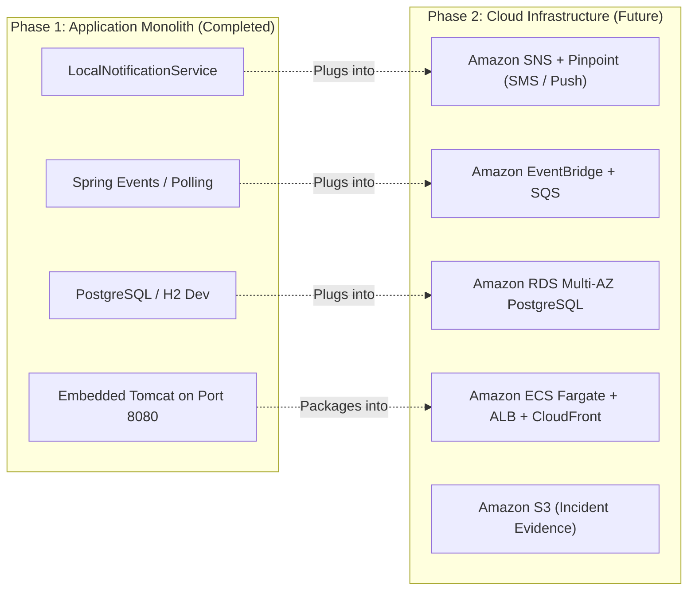

# ResQCloud — Intelligent Emergency Response & Resource Coordination Platform

[](https://openjdk.org/)
[](https://spring.io/projects/spring-boot)
[](https://spring.io/projects/spring-security)
[](https://www.postgresql.org/)
[](http://localhost:8080/swagger-ui.html)
[](LICENSE)

---

## 1. Problem Statement

During critical incidents—fires, multi-vehicle collisions, flash floods, mass-casualty medical events, and structural collapses—every second counts. Conventional emergency coordination frequently suffers from:

- **Fragmented reporting**: Citizens struggle to convey precise location, severity, and context.
- **Subjective triage**: Incidents are queued first-in-first-out rather than prioritized by quantified algorithmic risk.
- **Suboptimal resource dispatch**: The closest vehicle may not possess required life-saving capabilities, or overloaded units are repeatedly dispatched while nearby assets sit idle.
- **Disconnected status visibility**: Lack of strict state machine enforcement leads to out-of-order responses, forgotten incidents, and untraceable decisions.

**ResQCloud** solves this by delivering a centralized, intelligent emergency response platform supporting the complete lifecycle:

$$\text{REPORT} \longrightarrow \text{VALIDATE} \longrightarrow \text{PRIORITIZE} \longrightarrow \text{ASSIGN} \longrightarrow \text{RESPOND} \longrightarrow \text{UPDATE} \longrightarrow \text{RESOLVE} \longrightarrow \text{ANALYZE}$$

---

## 2. Core Capabilities & Highlights

- **Dynamic Multi-Factor Priority Engine**: Calculates normalized priority scores (0–100) and severity bands (`LOW`, `MEDIUM`, `HIGH`, `CRITICAL`) using mathematical weighting of severity, victim headcount, hazard type, time elapsed, and local resource availability.
- **Intelligent Resource Matching Engine**: Dispatches units using composite scoring ($40\%$ capability match + $35\%$ distance proximity via Haversine great-circle formula + $25\%$ current unit workload).
- **Enforced Lifecycle State Machine**: Strictly validates valid state transitions (`REPORTED` $\rightarrow$ `UNDER_REVIEW` $\rightarrow$ `PRIORITIZED` $\rightarrow$ `ASSIGNED` $\rightarrow$ `RESPONDER_EN_ROUTE` $\rightarrow$ `IN_PROGRESS` $\rightarrow$ `RESOLVED` $\rightarrow$ `CLOSED`). Prohibits illegal transitions (e.g. `CLOSED` $\rightarrow$ `IN_PROGRESS`) and maintains an immutable audit trail.
- **Role-Based Access Control (RBAC)**: Enforced via stateless JWT tokens with role-specific views (`CITIZEN`, `RESPONDER`, `COORDINATOR`, `ADMIN`).
- **Real-Time Operational Feel**: WebSocket / STOMP broker integration (`/ws-resqcloud`) with automated polling fallback for instantaneous dispatch updates.
- **Immutable Audit Logging**: Every administrative action, state transition, and assignment is preserved with before/after state snapshots and user attribution.
- **Turnkey Production Architecture**: Single-page responsive operations interface embedded directly in Spring Boot static resources—run the backend JAR and the entire system is immediately live at `http://localhost:8080`.
- **Cloud-Ready Abstractions**: Business logic is decoupled from transport mechanisms, preparing the platform for seamless AWS integration (ECS, RDS, SQS, SNS, S3, EventBridge) in future phases.

---

## 3. Technology Stack

| Layer | Technologies |
| :--- | :--- |
| **Language & Runtime** | Java 17 LTS |
| **Framework** | Spring Boot 3.3.4 (Spring Web, Spring Data JPA, Spring Security, Validation) |
| **Database** | PostgreSQL (Production/Dev), H2 in PostgreSQL compatibility mode (Standalone Dev/Test) |
| **ORM & Migrations** | Hibernate 6.5+, Jakarta Persistence, Schema DDL |
| **Security & Auth** | Spring Security 6, JJWT 0.12.6 (HMAC-SHA256), BCrypt Password Hashing |
| **Real-time Messaging** | Spring WebSocket, STOMP Protocol, SockJS |
| **API Documentation** | SpringDoc OpenAPI 3.0 / Swagger UI |
| **Testing** | JUnit 5, Mockito, Spring Boot Test, Spring Security Test, MockMvc |
| **Build Tool** | Apache Maven 3.9+ |
| **Frontend UI** | Responsive Semantic HTML5, CSS3 Emergency Design System, Vanilla ES6+ SPA |

---

## 4. Quick Start & Setup

### Prerequisites
- **JDK 17** or higher (`java -version`)
- **Maven 3.8+** (`mvn -version`)

### 1. Build and Run Application
Clone or navigate to the repository directory and execute:

```bash
# Clean, compile, and run tests
mvn clean test

# Run application using Maven
mvn spring-boot:run
```

*Alternatively, package and run the standalone executable JAR:*

```bash
mvn package -DskipTests
java -jar target/resqcloud-platform-1.0.0-SNAPSHOT.jar
```

The application will start on **`http://localhost:8080`**.

### 2. Access the Platform
- **Emergency Operations Portal (UI)**: [http://localhost:8080](http://localhost:8080)
- **Interactive Swagger API Documentation**: [http://localhost:8080/swagger-ui.html](http://localhost:8080/swagger-ui.html)
- **OpenAPI 3.0 Specification**: [http://localhost:8080/v3/api-docs](http://localhost:8080/v3/api-docs)
- **H2 Database Console** *(dev profile)*: [http://localhost:8080/h2-console](http://localhost:8080/h2-console) (JDBC URL: `jdbc:h2:mem:resqcloud_dev`, User: `sa`, Password: *empty*)

---

## 5. Pre-Seeded Demo Personas

The system bootstraps with realistic emergency response data on first launch:

| Persona | Username | Password | Role | Description |
| :--- | :--- | :--- | :--- | :--- |
| **Coordinator** | `coordinator` | `Password123!` | `ROLE_COORDINATOR` | Operational Triage, Intelligent Dispatch, Lifecycle Management |
| **Administrator** | `admin` | `Password123!` | `ROLE_ADMIN` | User & Resource Management, Full Compliance Audit Explorer |
| **Responder (Medic)** | `medic_sarah` | `Password123!` | `ROLE_RESPONDER` | Advanced Life Support Paramedic (Mobile ICU Unit) |
| **Responder (Fire)** | `fire_chief_dave` | `Password123!` | `ROLE_RESPONDER` | Structural Fire & Hazmat Commander |
| **Citizen** | `citizen_john` | `Password123!` | `ROLE_CITIZEN` | Public emergency reporter & status tracking |

*Quick switcher buttons are available directly on the web interface sidebar for seamless demo navigation.*

---

## 6. Configuration Profiles

Configuration files are located in `src/main/resources/`:

- **`application.yml`**: Shared configuration, priority engine weights, JWT token expiration, and OpenAPI settings.
- **`application-dev.yml`** *(Active default)*: In-memory PostgreSQL compatibility mode or local PostgreSQL with automatic schema updates.
- **`application-test.yml`**: Isolated in-memory database with `create-drop` schema for deterministic JUnit integration test runs.
- **`application-prod.yml`**: Production PostgreSQL configuration expecting environment variables (`SPRING_DATASOURCE_URL`, `SPRING_DATASOURCE_USERNAME`, `SPRING_DATASOURCE_PASSWORD`).

### Deploying with External PostgreSQL
To point the application to an external PostgreSQL instance:

```bash
export SPRING_PROFILES_ACTIVE=prod
export SPRING_DATASOURCE_URL=jdbc:postgresql://your-db-host:5432/resqcloud
export SPRING_DATASOURCE_USERNAME=postgres
export SPRING_DATASOURCE_PASSWORD=your_secure_password
export JWT_SECRET=YourBase64Encoded256BitSecretKeyHere

java -jar target/resqcloud-platform-1.0.0-SNAPSHOT.jar
```

The production schema DDL script is located at:
[`src/main/resources/schema-postgresql.sql`](file:///c:/Users/Admin/OneDrive/Documents/placementDrive/AWSbased%20Project/ResQcloud/src/main/resources/schema-postgresql.sql).

---

## 7. REST API Reference Overview

All REST endpoints (except public `/api/auth/**` and swagger docs) require a Bearer JWT token in the `Authorization: Bearer <token>` HTTP header.

### Authentication & Users
- `POST /api/auth/register` — Register a citizen, responder, coordinator, or admin.
- `POST /api/auth/login` — Authenticate and receive a signed JWT token.
- `GET /api/auth/me` — Retrieve the currently authenticated user profile.
- `PUT /api/users/profile` — Update user details.
- `POST /api/users/responder/status` — Responder toggles availability (`AVAILABLE`, `BUSY`, `OFFLINE`).

### Incidents
- `POST /api/incidents` — Report an emergency incident (automatically triggers Priority Calculation Engine).
- `GET /api/incidents` — Search and filter incidents with multi-field criteria and pagination.
- `GET /api/incidents/{id}` — Get incident details.
- `GET /api/incidents/{id}/details` — Get incident with complete state transition history and resource assignments.
- `PUT /api/incidents/{id}` — Update incident description, severity, or affected people.
- `POST /api/incidents/{id}/prioritize` — Recalculate priority score.
- `POST /api/incidents/{id}/status` — Execute a controlled lifecycle state transition.

### Resources & Intelligent Matching
- `GET /api/resources` — List emergency resources with type, status, and location filters.
- `POST /api/resources` — Register a new emergency unit (Ambulance, Fire Engine, etc.).
- `GET /api/resources/available` — Query currently available units.
- `GET /api/resources/matching/{incidentId}` — **Intelligent Resource Matcher**: Returns ranked units sorted by suitability score.
- `POST /api/resources/{incidentId}/assign` — Assign unit and/or responder to incident.
- `POST /api/resources/{id}/release` — Release resource back to available fleet.

### Dashboards & Analytics
- `GET /api/dashboard/summary` — High-level platform statistics (active, critical, available units, response times).
- `GET /api/dashboard/coordinator` — Operational queue and dispatch metrics.
- `GET /api/dashboard/responder` — Responder assigned incidents and status.
- `GET /api/dashboard/citizen` — Citizen reported emergencies and updates.
- `GET /api/analytics/overview` — Detailed metric breakdowns by incident type and severity.

### Audit & Notifications
- `GET /api/audit-logs` — Query immutable system audit logs with entity and action filters.
- `GET /api/notifications` — Fetch user notifications.
- `PATCH /api/notifications/{id}/read` — Acknowledge specific notification.

---

## 8. Testing & Verification

The project includes an automated test suite with **100% test pass rate** covering unit and end-to-end integration scenarios:

```bash
mvn test
```

### Verified Test Suites:
1. **`RuleBasedPriorityCalculationEngineTest`**: Verifies score bounds, low-severity handling, critical multi-victim calculations, and threshold bucket assignments.
2. **`HeuristicResourceMatchingEngineTest`**: Verifies capability-aware prioritization (e.g. prioritizing nearest Ambulance for medical emergencies over closer fire engines), distance scoring, and workload penalties.
3. **`IncidentStateTransitionServiceTest`**: Tests valid lifecycle transitions (`REPORTED` $\rightarrow$ `UNDER_REVIEW`), verifies strict rejection of illegal state changes (e.g. `REPORTED` $\rightarrow$ `RESOLVED`), and verifies same-state transition guards.
4. **`JwtTokenProviderTest`**: Tests HMAC token generation, claims extraction, expired token rejection, and malformed token prevention.
5. **`AuthControllerIntegrationTest`**: Tests registration, successful login with JWT issuance, and bad credential rejection.
6. **`IncidentControllerIntegrationTest`**: Tests unauthenticated 401 rejection, citizen emergency reporting with auto-priority evaluation, and multi-parameter filtering.
7. **`ResourceControllerIntegrationTest`**: Tests available resource queries and intelligent match recommendations via MockMvc.

---

## 9. Project Directory Structure

```
ResQcloud/
├── pom.xml                                     # Maven build definition & dependencies
├── README.md                                   # Comprehensive project manual
├── ARCHITECTURE.md                             # Architectural deep-dive & Mermaid diagrams
└── src/
    ├── main/
    │   ├── java/com/resqcloud/
    │   │   ├── ResQCloudApplication.java       # Application entry point
    │   │   ├── analytics/                      # Operational analytics & dashboards
    │   │   ├── common/                         # Cross-cutting concerns
    │   │   │   ├── audit/                      # AuditLog entity, repository & service
    │   │   │   ├── exception/                  # GlobalExceptionHandler & custom exceptions
    │   │   │   ├── response/                   # ApiResponse & PagedResponse wrappers
    │   │   │   └── utils/                      # GeoLocationUtils (Haversine formula)
    │   │   ├── config/                         # SecurityConfig, WebSocketConfig, OpenApiConfig
    │   │   ├── incident/                       # Incident domain module
    │   │   │   ├── entity/                     # Incident, History, Severity, Status enums
    │   │   │   ├── service/                    # IncidentService, PriorityService, StateTransitionService
    │   │   │   ├── service/priority/           # PriorityCalculationStrategy & RuleBasedEngine
    │   │   │   └── controller/                 # IncidentController REST endpoints
    │   │   ├── notification/                   # Notification abstraction & local implementation
    │   │   ├── resource/                       # Emergency resource inventory & matching
    │   │   │   ├── entity/                     # Resource, ResourceAssignment, ResourceType
    │   │   │   ├── service/                    # ResourceService, ResourceMatchingService
    │   │   │   └── controller/                 # ResourceController REST endpoints
    │   │   ├── security/                       # JWT filter, token provider, UserPrincipal
    │   │   ├── seeder/                         # DataSeeder for bootstrap demo initialization
    │   │   └── user/                           # User management, roles & authentication
    │   └── resources/
    │       ├── application.yml                 # Base application configuration
    │       ├── application-dev.yml             # Development profile
    │       ├── application-test.yml            # Automated testing profile
    │       ├── application-prod.yml            # Production PostgreSQL profile
    │       ├── schema-postgresql.sql           # Production PostgreSQL DDL schema
    │       └── static/                         # Web SPA UI (index.html, styles.css, app.js)
    └── test/java/com/resqcloud/
        ├── controller/                         # Controller integration test suites
        ├── incident/service/                   # State machine & priority engine unit tests
        ├── resource/service/                   # Intelligent matching unit tests
        └── security/                           # JWT token provider unit tests
```

---

## 10. Future AWS Cloud Integration Roadmap

The platform's business logic has been designed with decoupled interfaces to allow simple cloud migration in future phases:



- **Notification Layer**: Switch `NotificationService` implementation from `LocalNotificationService` to `AwsNotificationService` without changing any incident or resource controllers.
- **Asynchronous Task Processing**: Delegate background priority recalculation and notifications to Amazon SQS and EventBridge.
- **Evidence Storage**: Attach incident scene images, videos, and documentation directly to Amazon S3 via secure pre-signed upload URLs.
- **Containerized Deployment**: Package the existing Spring Boot executable JAR into a lightweight Distroless container deployed on Amazon ECS (Fargate) behind an Application Load Balancer (ALB).

---

## 11. License

This project is licensed under the Apache 2.0 License.
